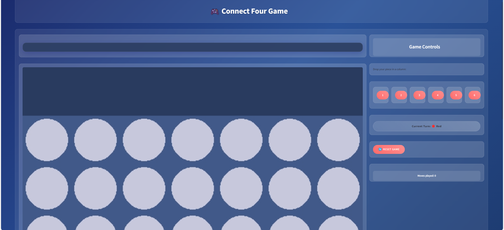
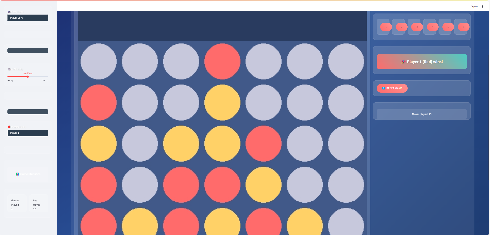
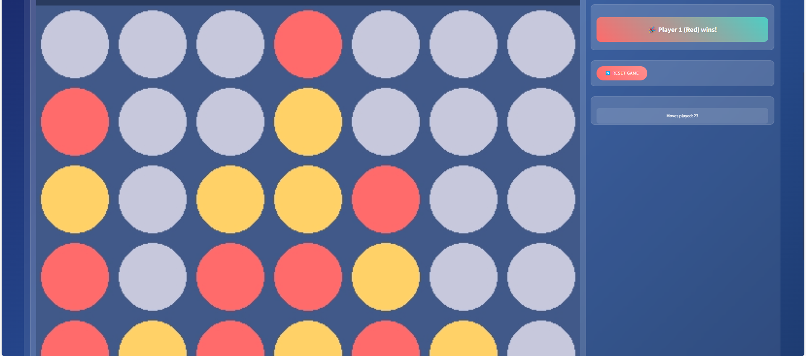

# 🎮 Connect Four Game

<div align="center">



[](https://github.com/yourusername/connect-four)
[](https://streamlit.io)
[](https://python.org)
[](LICENSE)

</div>

A modern implementation of the classic Connect Four game featuring both web-based (Streamlit) and command-line interfaces, with an enhanced user experience and sleek design.

## 📸 Screenshots

<div align="center">
  
  <p><em>Main gameplay screen with modern UI</em></p>
  
  
  <p><em>Victory celebration screen</em></p>
</div>

## ✨ Features

- 🎨 **Modern UI Design**
  - Sleek gradient backgrounds
  - Smooth animations
  - Responsive layout
  - Glass-morphism effects

- 🎮 **Game Modes**
  - Web application (Streamlit)
  - Command-line interface
  - Player vs Player
  - Player vs AI (Coming Soon)

- 🏆 **Game Features**
  - Win detection (horizontal, vertical, diagonal)
  - Draw detection
  - Move validation
  - Game statistics tracking
  - Easy reset functionality

- 📊 **Statistics & History**
  - Game duration tracking
  - Move counting
  - Win/loss records
  - SQLite database integration

## 🚀 Quick Start

1. **Clone the repository**
   ```bash
   git clone https://github.com/yourusername/connect-four.git
   cd connect-four
   ```

2. **Set up virtual environment**
   ```bash
   python -m venv venv
   source venv/bin/activate  # On Windows: venv\Scripts\activate
   ```

3. **Install dependencies**
   ```bash
   pip install -r requirements.txt
   ```

4. **Run the game**
   - Web Version:
     ```bash
     streamlit run app.py
     ```
   - CLI Version:
     ```bash
     python connect_four.py
     ```

## 🎯 How to Play

1. **Web Version**
   - Open your browser to the displayed URL (usually http://localhost:8501)
   - Click column buttons to drop pieces
   - First to connect four in any direction wins!

2. **CLI Version**
   - Enter column numbers (1-7) to drop pieces
   - Follow the on-screen instructions
   - Type 'quit' to exit

## 🛠️ Technical Details

### Architecture

```
connect-four/
├── app.py                 # Streamlit web interface
├── connect_four.py        # Core game logic
├── ai_player.py          # AI opponent (WIP)
├── sound_manager.py      # Sound effects
├── logger.py             # Logging system
└── tests/               # Test suite
```

### Technologies Used

- **Frontend**: Streamlit, Custom CSS
- **Backend**: Python 3.13+
- **Database**: SQLite
- **Testing**: pytest
- **Graphics**: Pygame
- **CI/CD**: GitHub Actions

## 📊 Database Schema

```sql
CREATE TABLE game_stats (
    id INTEGER PRIMARY KEY AUTOINCREMENT,
    player1_name TEXT NOT NULL,
    player2_name TEXT NOT NULL,
    winner INTEGER NOT NULL,
    moves_count INTEGER NOT NULL,
    duration_seconds INTEGER NOT NULL,
    timestamp DATETIME DEFAULT CURRENT_TIMESTAMP
);
```

## 🤝 Contributing

Contributions are welcome! Please feel free to submit a Pull Request. For major changes, please open an issue first to discuss what you would like to change.

1. Fork the repository
2. Create your feature branch (`git checkout -b feature/AmazingFeature`)
3. Commit your changes (`git commit -m 'Add some AmazingFeature'`)
4. Push to the branch (`git push origin feature/AmazingFeature`)
5. Open a Pull Request

## 📝 License

This project is licensed under the MIT License - see the [LICENSE](LICENSE) file for details.

## 👤 Author

**Your Name**
- GitHub: [@yourusername](https://github.com/yourusername)
- LinkedIn: [Your LinkedIn](https://linkedin.com/in/yourusername)

---

<div align="center">
  Made with ❤️ and Python
Enjoy the game! 🎮
