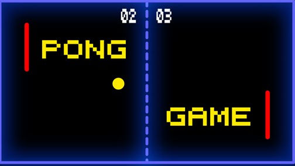

# 🏓 Classic Pong Game

[](https://opensource.org/licenses/MIT)


A nostalgic recreation of the classic Pong arcade game, built with Python's Turtle graphics module.



## ✨ Features

- 🎮 Two-player gameplay with keyboard controls
- 🎯 Dynamic ball physics with increasing difficulty
- 🏆 First to 5 points wins
- ⏯️ Pause and resume functionality
- 🔄 Game reset option
- 📱 Streamlit web interface for easy download and instructions

## 🚀 How to Play

### Controls

#### Player A (Left - Pink Paddle)
- **W key**: Move paddle up
- **S key**: Move paddle down

#### Player B (Right - Cyan Paddle)
- **↑ (Up Arrow)**: Move paddle up
- **↓ (Down Arrow)**: Move paddle down

### Game Controls
- **P key**: Pause/Resume game
- **R key**: Reset game

## 📋 Requirements

- Python 3.6+
- Python turtle module (included in standard library)
- Streamlit (for web interface) - `pip install streamlit`

## 💻 Installation

1. Clone this repository:
```bash
git clone https://github.com/asadullah48/pong-game.git
cd pong-game
```

2. Run the game directly:
```bash
python pong_game.py
```

3. Or launch the Streamlit app:
```bash
streamlit run app.py
```

## 🌐 Streamlit Deployment

This project includes a Streamlit app that provides a web interface for downloading and learning about the game.

To deploy on Streamlit Cloud:

1. Fork this repository
2. Visit [Streamlit Sharing](https://streamlit.io/sharing)
3. Create a new app and connect to your forked repository
4. Deploy!

## 📝 Commit History

- 🎮 Initial pong game implementation with basic functionality
- 🎯 Added ball physics and paddle collision improvements
- 🏆 Implemented scoring system and win conditions
- ⏸️ Added pause and reset functionality
- 🎨 Enhanced UI with divider line and better colors
- 📱 Added Streamlit web interface for easier distribution
- 📚 Created comprehensive README.md and documentation

## 🔧 Customization

You can easily customize the game by modifying variables in the `PongGame` class:

- Change the winning score: `self.winning_score = 5`
- Adjust ball speed: `self.ball.dx = 0.3` and `self.ball.dy = 0.3`
- Modify paddle sizes: `paddle_a.shapesize(stretch_wid=6, stretch_len=1)`
- Change colors: `paddle_a.color("deep pink")`

## 🤝 Contributing

Contributions are welcome! Feel free to submit a Pull Request.

1. Fork the repository
2. Create your feature branch (`git checkout -b feature/amazing-feature`)
3. Commit your changes (`git commit -m '🚀 Add some amazing feature'`)
4. Push to the branch (`git push origin feature/amazing-feature`)
5. Open a Pull Request

## 📜 License

This project is licensed under the MIT License - see the LICENSE file for details.

## 👤 Authors

- Original game by Saira
- Enhanced by [Asadullah](https://github.com/asadullah48)

---

Made with ❤️ using Python and Turtle Graphics."# pong-game" 
