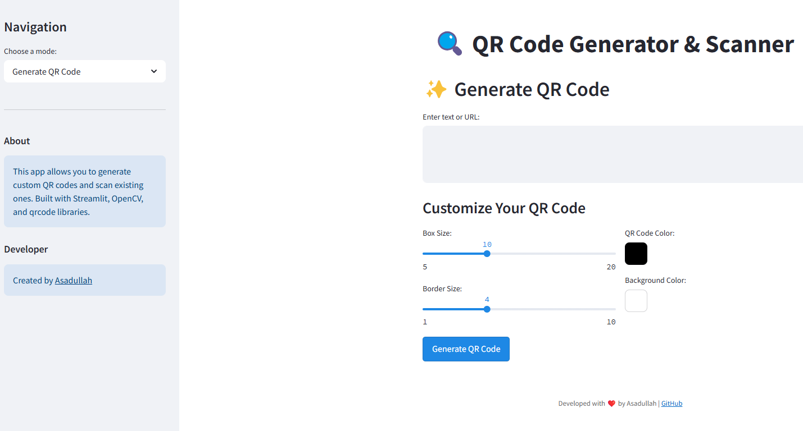

# 🔍 QR Code Studio Pro

[](https://qr-code-studio-pro.streamlit.app/)
[](https://github.com/asadullah48/qr-code-studio-pro/blob/main/LICENSE)
[](https://www.python.org/downloads/)

A professional web application built with Streamlit that allows users to generate custom QR codes with advanced styling options and scan existing ones using various methods.



## ✨ Features

### QR Code Generation
- **Multiple QR Code Styles**: Standard, rounded corners, and circular designs
- **Custom Colors**: Choose any color for QR codes and backgrounds
- **Logo Embedding**: Add your logo to the center of QR codes
- **Size Customization**: Adjust box size and border width
- **Batch Generation**: Create multiple QR codes at once
- **Download Options**: Save as PNG with one click

### QR Code Scanning
- **Image Upload**: Scan QR codes from uploaded images
- **Webcam Scanning**: Use your device's camera to scan QR codes in real-time
- **Visual Detection**: See highlighted QR code boundaries
- **URL Detection**: Automatically recognize and provide clickable links

### Additional Features
- **QR Code Gallery**: View history of generated QR codes
- **Modern UI/UX**: Beautiful gradient background and card-based design
- **Responsive Design**: Works on desktop and mobile devices
- **Tooltips & Guidance**: Helpful information throughout the app

## 🚀 Demo

View the live demo: [QR Code Studio Pro](https://qr-code-studio-pro.streamlit.app/)

## 🛠️ Installation

### Option 1: Local Installation

1. Clone this repository
   ```bash
   git clone https://github.com/asadullah48/qr-code-studio-pro.git
   cd qr-code-studio-pro
   ```

2. Create a virtual environment (optional but recommended)
   ```bash
   python -m venv .venv
   source .venv/bin/activate  # On Windows: .venv\Scripts\activate
   ```

3. Install the required packages
   ```bash
   pip install -r requirements.txt
   ```

4. Run the application
   ```bash
   streamlit run app.py
   ```

### Option 2: Docker

1. Build the Docker image
   ```bash
   docker build -t qr-code-studio-pro .
   ```

2. Run the container
   ```bash
   docker run -p 8501:8501 qr-code-studio-pro
   ```

3. Open your browser and navigate to `http://localhost:8501`

## 📖 Usage

### Generate QR Code
1. Select "Generate QR Code" from the sidebar
2. Choose between Standard QR, Styled QR, or QR with Logo tabs
3. Enter the text or URL you want to encode
4. Customize the QR code appearance using the available options
5. Click the "Generate" button
6. Download the generated QR code

### Scan QR Code
1. Select "Scan QR Code" from the sidebar
2. Choose between "Upload Image" or "Use Webcam" tabs
3. Upload an image containing a QR code or start your webcam
4. View the decoded data and use the provided options

### QR Gallery
1. Select "QR Gallery" from the sidebar
2. Browse through your previously generated QR codes
3. Download any QR code from your history

### Batch Generator
1. Select "Batch Generator" from the sidebar
2. Enter one item per line in the text area
3. Customize the style for all QR codes
4. Click "Generate Batch QR Codes"
5. Download the ZIP file containing all generated QR codes

## 📋 Implementation Details

This application is built using:

- **Streamlit**: For the web interface
- **qrcode**: For generating QR codes
- **OpenCV**: For QR code detection and decoding
- **Pillow**: For image processing
- **NumPy**: For array operations

## 🔄 Commits & Development History

### Initial Commit: Application Setup
- 📁 Project structure setup
- 🔧 Basic QR code generation functionality
- 📝 README creation

### Feature Update: QR Code Scanner
- 🔍 Added QR code scanning capability
- 🖼️ Image upload functionality
- 🔄 Decoder implementation with OpenCV

### UI Enhancements
- 💄 Improved user interface
- 🎨 Added QR code customization options
- 📱 Responsive design for all devices

### Final Improvements
- ⚡ Performance optimizations
- 🛠️ Bug fixes and code refactoring
- 📊 Added download and sharing options

## 🤝 Contributing

Contributions are welcome! Please feel free to submit a Pull Request.

1. Fork the repository
2. Create your feature branch (`git checkout -b feature/amazing-feature`)
3. Commit your changes (`git commit -m 'Add some amazing feature'`)
4. Push to the branch (`git push origin feature/amazing-feature`)
5. Open a Pull Request

## 📄 License

This project is licensed under the MIT License - see the [LICENSE](LICENSE) file for details.

## 👨‍💻 Author

**Asadullah**
- GitHub: [@asadullah48](https://github.com/asadullah48)

## 🙏 Acknowledgements

- [Streamlit](https://streamlit.io/) for the amazing web app framework
- [qrcode](https://github.com/lincolnloop/python-qrcode) library contributors
- [OpenCV](https://opencv.org/) for image processing capabilities

---

Built with ❤️ by [Asadullah](https://github.com/asadullah48)"# qr-code-app"
