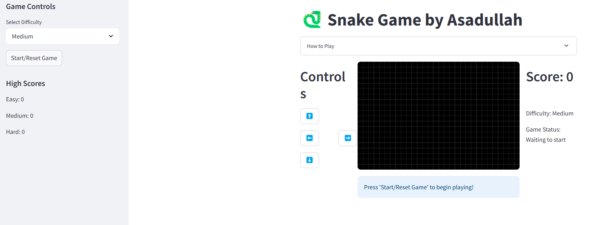

# 🐍 Snake Game Pro

A modern, enhanced Snake game with professional UI/UX and exciting features, created by asadullah48 (GitHub: [@asadullah48](https://github.com/asadullah48))



## ✨ Features

- 🎮 Classic snake gameplay with intuitive controls
- 🎯 Multiple difficulty levels (Easy, Medium, Hard)
- 🏆 High score tracking system with leaderboard
- 🎁 Special bonus food items worth extra points
- ⏸️ Pause/resume functionality
- 🌐 Web version using Streamlit for online play
- 🎨 Multiple game themes (Classic, Neon, Retro, Dark)
- ⚡ Power-ups system (Speed Boost, Shield, Double Points)
- ⌨️ Keyboard support for web version
- ⏱️ Game timer and countdown
- 🎯 Improved visuals with custom graphics

## 🚀 Play Online

You can play the web version of this game directly in your browser!

[](https://snake-game-app.streamlit.app/)

## 🖥️ Local Installation

### Prerequisites

- Python 3.7+
- Pygame (for desktop version)
- Streamlit (for web version)

### Installation Steps

1. Clone this repository
```bash
git clone https://github.com/asadullah48/snake-game.git
cd snake-game
```

2. Install required packages
```bash
pip install -r requirements.txt
```

3. Run the desktop version
```bash
python snake_game.py
```

4. Or run the web version with Streamlit
```bash
streamlit run streamlit_snake.py
```

## 🎮 How to Play

- Use arrow keys (desktop and web) or direction buttons (web) to control the snake
- Eat red apples to grow longer and earn points
- Golden apples are special and worth 3 points!
- Collect power-ups for special abilities:
  - 🔵 **Speed Boost**: Temporarily increases snake speed
  - 🟣 **Shield**: Protects from one collision
  - 🟠 **Double Points**: Doubles points for a limited time
- Avoid hitting walls or your own body
- Press 'P' to pause/resume the game
- Try different themes for a fresh visual experience

## 🛠️ Technical Details

This game was built using:
- Python 3.x
- Pygame for the desktop version and game rendering
- Streamlit for the web version and UI components
- Custom CSS for enhanced styling
- PIL for image processing
- JSON for high score and leaderboard storage
- Custom-generated assets for improved visuals

## 🤝 Contributing

Contributions are welcome! Please feel free to submit a Pull Request.

1. Fork the repository
2. Create your feature branch (`git checkout -b feature/amazing-feature`)
3. Commit your changes (`git commit -m 'Add some amazing feature'`)
4. Push to the branch (`git push origin feature/amazing-feature`)
5. Open a Pull Request

## 📄 License

This project is licensed under the MIT License - see the [LICENSE](LICENSE) file for details.

## 🙏 Acknowledgements

- Original Snake game concept
- Pygame community for their excellent documentation
- Streamlit for making web deployment simple
- The open-source community for inspiration

## 🔮 Future Enhancements

- Multiplayer mode
- More power-ups and obstacles
- Custom snake skins
- Sound effects and background music
- Mobile-responsive design
- User accounts and global leaderboard

---

Made with ❤️ by Saira | [@asadullah48](https://github.com/asadullah48)
